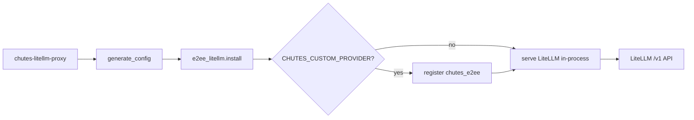
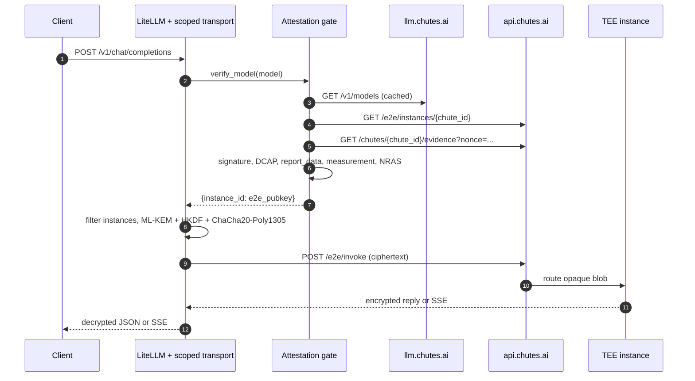

# How it works

## Who this is for

Maintainers and integrators who need to understand what starts, what gets
verified, and where a Chutes request is encrypted before changing the proxy or
debugging an attestation failure.

## What you'll learn

- how `chutes-litellm-proxy` turns a template into a running LiteLLM server,
- how provider and model prefixes are routed,
- the request path for a Chutes `*-TEE` call, including key establishment and
  streaming,
- the mandatory attestation gate, its cache, and its failure semantics,
- the trust boundaries and the parts of the system it does not cover.

The byte-level cryptography is in
[end-to-end encryption](e2ee-encryption.md); the full evidence checks are in
[TEE and GPU attestation](attestation.md). This page connects them to the code.

## Component map

| Component | Responsibility |
| --------- | -------------- |
| `src/chutes_litellm/cli.py` | Parse `--config` / `--host` / `--port`, generate config, install transport, serve LiteLLM in-process. |
| `src/chutes_litellm/generate_config.py` | Expand wildcard providers into concrete `model_list` entries. |
| `src/chutes_litellm/config/config.template.yml` | Bundled source of truth for the provider list. |
| `src/chutes_litellm/e2ee_litellm.py` | Host-scoped swap of LiteLLM's OpenAI-SDK HTTP clients for the Chutes E2EE transport. |
| `src/chutes_litellm/custom_provider.py` | Optional self-contained `chutes_e2ee/` provider, registered through `litellm.custom_provider_map`. |
| `src/chutes_litellm/attestation.py` | Network discovery, evidence fetch, cache, and the fail-closed gate. |
| `src/chutes_litellm/tee/` | Evidence parsing, DCAP quote verification, measurement matching, NRAS GPU verification. |
| `src/chutes_litellm/endpoints.py` | The two fixed Chutes base URLs. |
| `scripts/live_server.py` | Test-only in-process launcher that serves a pre-expanded config and can pick a free port. |



The key point: config generation is a one-time startup step; the request path is
LiteLLM plus a scoped HTTP transport, not a separate proxy.

## Startup sequence

`chutes-litellm-proxy` is a thin startup wrapper around LiteLLM's server.

1. **Parse arguments.** `--config` overrides `LITELLM_TEMPLATE`; `--host`
   overrides `LITELLM_HOST`; `--port` overrides `LITELLM_PORT`. Defaults are the
   packaged template, `0.0.0.0`, and `4000`. A missing `--config` file or an
   invalid port exits with status `2` before any config is written.
2. **Generate the config.** `generate(template, output)` loads the template,
   expands wildcard providers, and writes `LITELLM_OUTPUT` (default
   `./config.generated.yml`). The parent directory is created.
3. **Install the E2EE transport.** `e2ee_litellm.install()` swaps
   `BaseOpenAILLM._get_sync_http_client` and `_get_async_http_client` for shared
   `httpx` clients whose transport encrypts only the fixed Chutes hosts. It is a
   no-op when `CHUTES_API_KEY` is unset or `chutes_e2ee` is not importable, so
   the other providers keep working. Before patching, it verifies that both
   transports expose the mandatory `instance_filter` hook and refuses to start
   otherwise, so an old/wrong `chutes-e2ee` build cannot silently serve Chutes
   without attested-instance pinning.
4. **Optionally register the custom provider.** A truthy
   `CHUTES_CUSTOM_PROVIDER` (`1`, `true`, `yes`, `on`) imports
   `chutes_litellm.custom_provider`, appends `chutes_e2ee` to
   `litellm.custom_provider_map`, and widens the supported OpenAI parameter list
   for that provider. The template must contain `chutes_e2ee/` models.
5. **Serve LiteLLM in-process.** The same process calls
   `litellm.run_server.main(..., standalone_mode=False)` with the generated
   config, the resolved host and port, and `--num_workers 1`. No new process is
   launched.

### In-process serving

The E2EE client swap and the custom-provider registration are process-global
Python state. Replacing the process image or forking fresh workers would discard
them, and the built-in `chutes/` provider would send plaintext. The CLI
therefore serves LiteLLM in the same process and pins uvicorn to one worker
(`--num_workers 1`).

`scripts/live_server.py` remains for live tests that serve an already-expanded
config and pick a free port; it is not a second deployment path. Multi-worker
subprocess deployment is not safe for this design because the additional
workers would not inherit the in-memory hooks.

## Config generation and routing

The bundled template contains one wildcard entry per provider:

```yaml
model_list:
  - model_name: "chutes/*"
    litellm_params:
      model: "chutes/*"
      api_key: "os.environ/CHUTES_API_KEY"
```

For each entry ending in `/*`, `generate_config` looks up the provider in its
registry, reads the provider's environment variable, fetches the provider's
model list, and emits one concrete entry per model:

```yaml
- model_name: "chutes/Qwen/Qwen3-32B-TEE"
  litellm_params:
    model: "chutes/Qwen/Qwen3-32B-TEE"
    api_key: "os.environ/CHUTES_API_KEY"
```

Important behaviours:

- Providers without a key are skipped, not fatal.
- Chutes keeps only ids ending in `-TEE` and adds `model_info` capability fields
  and the context limit used by opencode. Output limits are reported as `0` so
  clients use their own default.
- Chutes entries also get `allowed_openai_params` so thinking/reasoning
  parameters are forwarded instead of dropped.
- Fixed (non-wildcard) entries are copied through unchanged, which is how a
  custom `chutes_e2ee/` model is configured.
- An unknown wildcard provider is left as-is rather than expanded.

LiteLLM then routes by the `model_name` prefix. `chutes/` uses LiteLLM's built-in
declarative `chutes` provider pointed at `https://llm.chutes.ai/v1`; the E2EE
transport sits underneath that provider. Other prefixes use their normal
LiteLLM provider. `chutes_e2ee/` is a distinct provider handled by
`custom_provider.py`, which strips the prefix before invoking upstream.

## Request path for a Chutes `*-TEE` request

A client sends a normal OpenAI request to the local proxy:

```sh
POST /v1/chat/completions
{"model":"chutes/Qwen/Qwen3-32B-TEE", ...}
```

1. **Host scoping.** The scoped transport checks the request host against the
   fixed Chutes hosts derived from `endpoints.API_BASE` and
   `endpoints.MODELS_BASE`. Only those hosts take the E2EE path; every other
   host uses a plain `httpx` transport with TLS verification on.
2. **Pre-send attestation.** For a Chutes request carrying a JSON `model`, the
   transport calls `verify_model(api_key, model)` before handing the request to
   the E2EE transport. A failure is raised before anything leaves the process.
3. **Model-to-chute lookup.** `verify_chute` resolves the model id to a
   `chute_id` from `https://llm.chutes.ai/v1/models` (cached).
4. **Instance discovery.** It fetches
   `GET https://api.chutes.ai/e2e/instances/{chute_id}` for the instance ids,
   ML-KEM public keys, and nonce pool.
5. **Evidence.** It generates a fresh random nonce and fetches
   `GET /chutes/{chute_id}/evidence?nonce=...`. Every listed instance must have
   evidence and verify; unmatched evidence is ignored.
6. **Gate result.** On success the gate returns
   `{instance_id: e2e_pubkey}`. The transport's `instance_filter` keeps only
   instances whose id and key both match that mapping, so a racing discovery
   response cannot substitute a different key for a verified id.
7. **Key establishment.** The transport builds an ephemeral ML-KEM-768 response
   key pair, encapsulates a shared secret to the instance public key, derives a
   request key with HKDF-SHA256, gzips the JSON payload, and encrypts it with
   ChaCha20-Poly1305.
8. **Encrypted invoke.** It sends `POST /e2e/invoke` with `X-Chute-Id`,
   `X-Instance-Id`, `X-E2E-Nonce`, `X-E2E-Path`, and `X-E2E-Stream`. The body is
   the framed ciphertext, not JSON.
9. **Reply.** The instance encapsulates to the client's ephemeral response key.
   The transport decapsulates, derives the response key, verifies and decrypts
   the AEAD, and hands LiteLLM a synthetic JSON response.
10. **Streaming.** For `stream: true`, the server first sends an encrypted
    `e2e_init` containing the stream key material, then one encrypted `e2e`
    event per SSE chunk. The plaintext `usage` event is forwarded as-is. The
    client refuses an `e2e` chunk that arrives before `e2e_init`.

The wire format, HKDF labels, nonces, and per-direction details are in
[end-to-end encryption](e2ee-encryption.md). The nonce in `X-E2E-Nonce` is a
control-plane freshness value bound into the evidence; it is not the AEAD nonce.



## Attestation gate

The gate is `attestation.verify_chute`; the cryptographic checks are in
`chutes_litellm.tee`.

### Evidence envelope

Each instance's evidence is a signed envelope containing at least
`instance_id`, `certificate`, `signature`, and `attested_body`. The signed body
contains the TDX quote and the NVIDIA evidence. Top-level `quote` /
`gpu_evidence` copies, when present, must agree with the signed body.

### Checks

1. **Signature.** RSA PKCS#1 v1.5 over SHA-256, verified with the certificate's
   public key. Missing certificate, signature, or body fails.
2. **Intel DCAP.** The TDX quote is verified with `dcap-qvl`; the status must be
   `UpToDate`, with no advisories and the debug bit off.
3. **Key binding.** `report_data[:32]` must equal
   `sha256(nonce + e2e_pubkey)` exactly.
4. **Certificate binding.** `report_data[32:64]` must equal
   `sha256(certificate SPKI DER)` exactly.
5. **Measurement.** MRTD and RTMR0-3 must match a published Chutes measurement
   exactly. The default source is
   `https://api.chutes.ai/servers/tee/measurements`; setting
   `CHUTES_TEE_MEASUREMENTS_FILE` makes a local YAML the sole source.
6. **NVIDIA NRAS.** Each GPU evidence blob is checked by the NVIDIA remote
   attestation service, and the number of GPUs must equal the matched
   measurement's `gpu_count`.

### All-instances rule and TOCTOU

`verify_chute` requires **every** instance listed by `/e2e/instances` to
verify. Accepting a partially verified chute would let the transport pick the
unverified instance. The transport installs an `instance_filter` on
`DiscoveryManager` that pins the verified `{instance_id: e2e_pubkey}` mapping,
closing the race between the gate's discovery call and the transport's own
cache.

### Cache and failure semantics

- Positive verdicts are cached per `chute_id` for
  `CHUTES_ATTESTATION_TTL` (default `300`).
- Failures are cached for `CHUTES_ATTESTATION_FAILURE_TTL` (default `30`).
- The model-to-chute map is cached for `CHUTES_ATTESTATION_MODEL_MAP_TTL`
  (default `300`).
- Cold-cache callers for the same chute are coalesced into one fetch.
- A failure raises `AttestationError`, which the transport wraps in a LiteLLM
  `APIError` with HTTP `503`. The request is not sent.

The full check list and error text are in
[TEE and GPU attestation](attestation.md).

## Fixed endpoints and TLS

`src/chutes_litellm/endpoints.py` defines two module constants:

```python
API_BASE = "https://api.chutes.ai"
MODELS_BASE = "https://llm.chutes.ai"
```

Production code reads them at call time. Tests monkeypatch the module
attributes to point at a local mock. There is no environment variable, CLI flag,
or Nix option that changes them in production, and the encrypted host set is
derived from them. Both the E2EE transport and the plain passthrough use
`httpx` transports with `verify=True`; TLS verification has no off switch.

## Trust boundaries and non-goals

**Covered.** The TDX quote covers the VM firmware, boot chain, and rootfs
(MRTD + RTMR0-3), and binds the E2EE key and certificate through
`report_data`. NVIDIA NRAS independently attests the GPU hardware. Together they
show that the key belongs to an approved VM image and GPU configuration.

**Not covered.**

- **Model weights.** No model id, revision, or weight digest is bound into the
  evidence. A passing verdict means "approved TDX image and GPU hardware with a
  bound key", not "this exact model revision is loaded". See
  [Model weights are not attested](attestation.md#14-model-weights-are-not-attested).
- **Control-plane metadata.** Model id, chute id, instance id, request and
  response sizes, timing, and token counts are visible to Chutes. The Chutes API
  key is sent as a bearer token.
- **Availability.** The gate can refuse a request when Chutes, PCCS, NRAS, or a
  pinned measurement source is unavailable; that is fail-closed, not a
  fallback.
- **Honest code inside the TEE.** Attestation proves what is running, not that
  it behaves correctly.
- **Exact GPU model string.** The verifier enforces the measurement's GPU count
  and the NRAS verdict; the `expected_gpus` list is used to detect conflicting
  measurements, not to prove an exact model string.

## Code and test map

| Concern | Where |
| ------- | ----- |
| CLI and startup | `src/chutes_litellm/cli.py` |
| Template expansion | `src/chutes_litellm/generate_config.py` |
| Fixed endpoints | `src/chutes_litellm/endpoints.py` |
| Host-scoped client swap | `src/chutes_litellm/e2ee_litellm.py` |
| Custom `chutes_e2ee/` provider | `src/chutes_litellm/custom_provider.py` |
| Gate, cache, discovery | `src/chutes_litellm/attestation.py` |
| Evidence, DCAP, measurements, NRAS | `src/chutes_litellm/tee/` |
| Attestation CLI | `src/chutes_litellm/verify.py` |
| Config-only / CLI wrappers | `scripts/generate_config.py`, `scripts/verify_attestation.py` |
| E2EE transport (vendored/fork) | `chutes-e2ee-transport/src/chutes_e2ee/` |
| Offline mock | `tests/mock_chutes_server.py` |

The two `scripts/` files are thin source-checkout wrappers around the library
modules; they do not contain a second implementation.

### Tests

The offline suite is hermetic. The mock speaks the real Chutes E2EE protocol and
holds the instance ML-KEM private key, so a passing request proves it was
genuinely encrypted. The tests fake only three boundaries:

- the DCAP call (`tee.quote._dcap_verify`),
- the measurement source,
- the NVIDIA SDK's `Attestation` client (the NRAS call is faked at the SDK
  boundary, not bypassed).

Production calls all three for real.

```sh
uv run pytest tests/ -q
uv run ruff check src tests scripts
```

Live tests are opt-in and use real Chutes endpoints:

```sh
CHUTES_LIVE_TEE=1 CHUTES_API_KEY=cpk_... \
  uv run pytest tests/test_live_attestation.py tests/test_live_proxy.py -v -s
```

Run the live modules on their own; the offline suite points the transport at
the mock. See [TEST.md](../TEST.md) for the full test layout and requirements.
